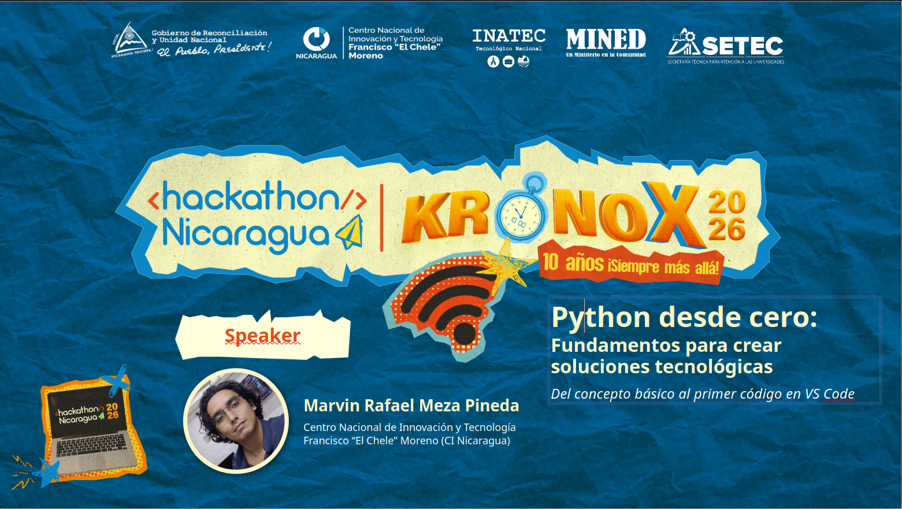
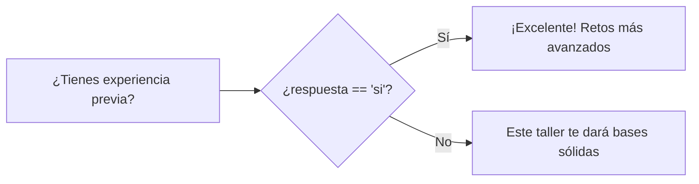
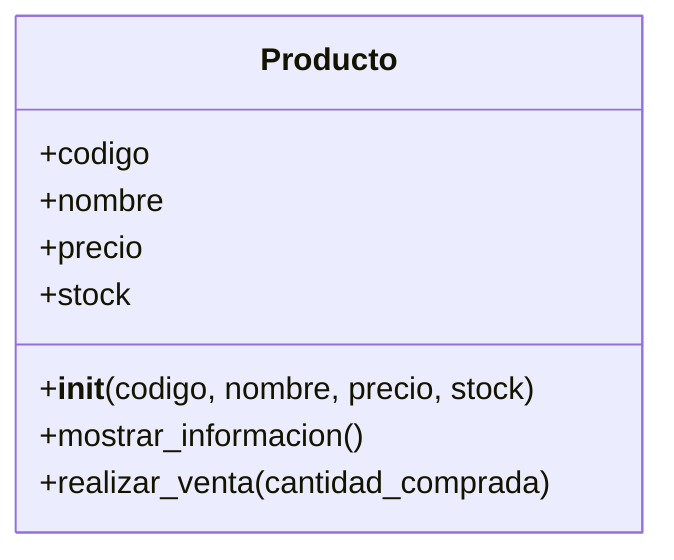

<p align="center">
  
</p>

<h1 align="center">🐍 Python desde cero</h1>

<p align="center">
  <b>Fundamentos para crear soluciones tecnológicas</b><br>
  Taller práctico · 8 de octubre de 2026 · CI Nicaragua
</p>

<p align="center">
  
  
  <br>
  
  
  
  
</p>

---

¡Bienvenido al repositorio oficial del taller! 👋
Durante 2 horas construiremos, línea por línea, un programa en Python que conversa con el usuario, toma decisiones, repite tareas, hace cálculos y modela productos de una tienda. Todo desde cero y con las manos en el teclado. ⌨️

> 💡 **Comprender la lógica de programación es más importante que memorizar código.**

---

## 📑 Contenido

- [🎯 Objetivo](#-objetivo)
- [🗓️ Agenda del taller](#️-agenda-del-taller)
- [🧰 Antes de empezar](#-antes-de-empezar)
- [▶️ Cómo ejecutar el programa](#️-cómo-ejecutar-el-programa)
- [🛠️ El taller paso a paso](#️-el-taller-paso-a-paso)
- [🖥️ Resultado esperado](#️-resultado-esperado)
- [🆘 Errores comunes](#-errores-comunes)
- [🏆 Retos para seguir practicando](#-retos-para-seguir-practicando)
- [📋 Chuleta de Python](#-chuleta-de-python)
- [📚 Para seguir aprendiendo](#-para-seguir-aprendiendo)
- [👨‍💻 Speaker](#-speaker)

---

## 🎯 Objetivo

Introducir a las y los participantes en los fundamentos de programación con **Python** mediante ejercicios prácticos que les permitan comprender la lógica de programación y desarrollar sus primeras soluciones tecnológicas.

<table>
  <tr>
    <td align="center" width="20%">📦<br><b>Variables</b><br>guardar datos</td>
    <td align="center" width="20%">🔀<br><b>Condicionales</b><br>tomar decisiones</td>
    <td align="center" width="20%">🔁<br><b>Bucles</b><br>repetir tareas</td>
    <td align="center" width="20%">🧩<br><b>Funciones</b><br>reutilizar código</td>
    <td align="center" width="20%">🏗️<br><b>Clases</b><br>modelar el mundo real</td>
  </tr>
</table>

---

## 🗓️ Agenda del taller

| ⏰ Hora | Bloque | Duración |
|:---:|---|:---:|
| 1:00 p.m. | 👋 Bienvenida y presentación del speaker | 5 min |
| 1:05 p.m. | 🧠 Introducción: ¿qué es Python y por qué aprenderlo? | 15 min |
| 1:20 p.m. | 🛠️ **Taller práctico** (bloques 1 al 5) | **75 min** |
| 2:35 p.m. | 💬 Preguntas, retroalimentación y conclusiones | 15 min |
| 2:50 p.m. | 📲 Escaneo de asistencia para certificación y cierre | 10 min |

### ⏱️ Así se reparten los 75 minutos de práctica

| Bloque | Tema | Tiempo |
|:---:|---|:---:|
| 0 | 🧰 Preparar el entorno y el primer `print()` | 5 min |
| 1 | 📦 Variables, tipos de datos e `input()` | 15 min |
| 2 | 🔀 Condicionales y bucles | 15 min |
| 3 | 🧩 Funciones | 10 min |
| 4 | 🏗️ Clases, constructores y métodos | 20 min |
| 5 | 🛒 Crear objetos y usarlos | 10 min |

---

## 🧰 Antes de empezar

- [ ] **Python 3** instalado → [python.org/downloads](https://www.python.org/downloads/)
- [ ] **Visual Studio Code** instalado → [code.visualstudio.com](https://code.visualstudio.com/)
- [ ] Extensión **Python** de Microsoft en VS Code (pestaña *Extensiones* → buscar `Python`)

> 🪟 **Al instalar Python en Windows**, marca la casilla **“Add python.exe to PATH”** en la primera pantalla del instalador. Si no la marcas, la terminal no encontrará Python.

Verifica tu instalación en la terminal:

```bash
python --version
# Python 3.x.x  ✅ ¡Estás listo!
```

> 💡 Si no funciona, prueba con `py --version` (Windows) o `python3 --version` (macOS y Linux).

### 📁 Estructura del repositorio

```text
📂 python-desde-cero-taller/
├── 🐍 taller.py                    ← el programa que construiremos juntos
├── 🖼️ Portada-Taller-Python.png
└── 📄 README.md                    ← esta guía
```

---

## ▶️ Cómo ejecutar el programa

1. Crea una carpeta para el taller y ábrela en VS Code (*Archivo → Abrir carpeta…*).
2. Crea un archivo llamado **`taller.py`**.
3. Escribe el código bloque por bloque (¡no lo copies y pegues: escribirlo es parte del aprendizaje! ✍️).
4. Ejecútalo de cualquiera de estas dos formas:

| Opción | Cómo |
|---|---|
| ▶️ **Botón Play** | Clic en el triángulo ▷ de la esquina superior derecha de VS Code |
| ⌨️ **Terminal** | `python taller.py` |

> 🧪 El programa te hará preguntas en la terminal: escribe tu respuesta y presiona **Enter**.

---

## 🛠️ El taller paso a paso

> Haz clic en cada bloque para desplegarlo 👇

<details>
<summary><b>🧰 Bloque 0 · Tu primer programa</b> &nbsp;·&nbsp; ⏱️ 5 min</summary>
<br>

La tradición de todo programador: hacer que la computadora salude.

```python
print("¡Hola, mundo!")
```

`print()` es una **función** que muestra en pantalla lo que pongas entre paréntesis. El texto siempre va entre comillas.

✅ **Lo lograste si** al ejecutar ves `¡Hola, mundo!` en la terminal.

</details>

<details>
<summary><b>📦 Bloque 1 · Variables, tipos de datos e input()</b> &nbsp;·&nbsp; ⏱️ 15 min</summary>
<br>

```python
print("==================================================")
print("   BIENVENIDOS AL TALLER DE PYTHON - CI NICARAGUA")
print("==================================================")

# 1. Variables y captura de datos por consola
nombre_participante = input("¿Cuál es tu nombre? ")
print(f"¡Hola, {nombre_participante}! Comencemos a programar.")

# 2. Operadores básicos y conversión de tipos
edad_str = input("¿Qué edad tienes? ")
edad = int(edad_str)  # Convertimos el texto ingresado a número entero
proxima_edad = edad + 1
print(f"El próximo año cumplirás {proxima_edad} años.")
```

### 🧠 Conceptos clave

| Concepto | Qué significa | En el código |
|---|---|---|
| **Variable** | Una “caja” con nombre donde guardas un dato | `nombre_participante = ...` |
| **`input()`** | Pregunta algo al usuario y guarda su respuesta | `input("¿Cuál es tu nombre? ")` |
| **`str` (texto)** | Todo lo que devuelve `input()` es **texto** | `edad_str` |
| **`int()`** | Convierte texto en número entero | `int(edad_str)` |
| **f-string** | Inserta variables dentro de un texto con `{ }` | `f"¡Hola, {nombre_participante}!"` |
| **`#` comentario** | Nota para personas; Python la ignora | `# Convertimos...` |

> ⚠️ **¿Por qué `int()`?** `input()` siempre devuelve texto. `"17" + 1` da error, pero `17 + 1` da `18`. Por eso convertimos primero.

🎯 **Mini reto:** pregunta también la ciudad del participante y muéstrala en el saludo.

</details>

<details>
<summary><b>🔀 Bloque 2 · Condicionales y bucles</b> &nbsp;·&nbsp; ⏱️ 15 min</summary>
<br>

```python
print("\n--- 2. CONTROL DE FLUJO Y LOGICA ---")

# Condicional (if / else)
nivel_experiencia = input("¿Tienes experiencia previa? (si/no): ").lower()

if nivel_experiencia == "si":
    print("-> ¡Excelente! Tienes bases para retos más avanzados.")
else:
    print("-> Perfecto. Este taller desde cero te dará bases sólidas.")

# Bucle (for) - Automatizando tareas repetitivas
print("\nIniciando sistema de carga de módulos:")
for modulo in range(1, 4):
    print(f">> Cargando módulo {modulo} de programación...")

print("¡Sistema listo y operativo! 🚀\n")
```

### 🔀 Así decide el programa



### 🧠 Conceptos clave

| Concepto | Qué significa |
|---|---|
| **`if` / `else`** | “Si se cumple esto, haz esto; si no, haz lo otro”. |
| **`==`** | Compara si dos valores son iguales (un solo `=` asigna; dos `==` comparan). |
| **`.lower()`** | Pasa el texto a minúsculas: así `"SI"`, `"Si"` y `"si"` funcionan igual. |
| **Indentación** | Los 4 espacios al inicio indican qué líneas pertenecen al `if`, al `else` o al `for`. ¡En Python es obligatoria! |
| **`for` + `range(1, 4)`** | Repite el bloque con los números 1, 2 y 3. El último número (**4**) **no se incluye**. |
| **`\n`** | Salto de línea dentro de un texto. |

🎯 **Mini reto:** cambia el `range` para que cargue 5 módulos.

</details>

<details>
<summary><b>🧩 Bloque 3 · Funciones</b> &nbsp;·&nbsp; ⏱️ 10 min</summary>
<br>

```python
print("--- 3. FUNCIONES ---")

def calcular_precio_con_iva(precio_base):
    """Función para calcular el precio final aplicando un impuesto del 15%"""
    iva = precio_base * 0.15
    total = precio_base + iva
    return total

# Probando la función
precio_original = 100.0
precio_final = calcular_precio_con_iva(precio_original)
print(f"Precio base: ${precio_original} | Precio con IVA (15%): ${precio_final}")
```

### 🧠 Conceptos clave

| Concepto | Qué significa |
|---|---|
| **`def`** | Define una función: un bloque de código con nombre que puedes reutilizar. |
| **Parámetro** | El dato que recibe la función (`precio_base`). |
| **`return`** | Devuelve el resultado a quien llamó la función. |
| **Docstring `"""..."""`** | Describe qué hace la función. |
| **`float`** | Número con decimales (`100.0`, `0.15`). |

> 🧩 **Piénsalo como una máquina:** entra un precio, sale el precio con IVA. Puedes usarla con 100, con 250 o con mil productos sin volver a escribir el cálculo.

🎯 **Mini reto:** crea una función `aplicar_descuento(precio, porcentaje)` y pruébala.

</details>

<details>
<summary><b>🏗️ Bloque 4 · Clases, constructores y métodos (POO)</b> &nbsp;·&nbsp; ⏱️ 20 min</summary>
<br>

Una **clase** es el **plano o molde**. Un **objeto** es el elemento real creado a partir de ese plano, con sus propios datos y acciones.

```python
class Producto:
    # 1. El Constructor: método especial que inicializa los atributos
    def __init__(self, codigo, nombre, precio, stock):
        self.codigo = codigo
        self.nombre = nombre
        self.precio = precio
        self.stock = stock

    # 2. Método de comportamiento: muestra la información
    def mostrar_informacion(self):
        print(f"[{self.codigo}] Producto: {self.nombre} | Precio: ${self.precio} | Stock disponible: {self.stock}")

    # 3. Método que modifica el estado interno
    def realizar_venta(self, cantidad_comprada):
        if cantidad_comprada <= self.stock:
            self.stock -= cantidad_comprada
            print(f"-> ¡Venta exitosa! Se vendieron {cantidad_comprada} unidad(es) de {self.nombre}.")
        else:
            print(f"-> ¡Error! No hay suficiente stock de {self.nombre} para completar la venta.")
```

### 🗺️ El plano de la clase



### 🧠 Conceptos clave

| Concepto | Qué significa |
|---|---|
| **`class`** | Crea el molde de una entidad (aquí, un producto de tienda). |
| **Atributos** | Los datos de cada objeto: `codigo`, `nombre`, `precio`, `stock`. |
| **`__init__`** | El **constructor**: se ejecuta automáticamente al crear un objeto y le asigna sus datos. |
| **`self`** | Significa “este objeto en particular”. Así cada producto guarda sus propios datos. |
| **Métodos** | Las acciones que puede hacer el objeto: `mostrar_informacion()` y `realizar_venta()`. |
| **`-=`** | Resta y guarda: `stock -= 2` es lo mismo que `stock = stock - 2`. |

</details>

<details>
<summary><b>🛒 Bloque 5 · Crear objetos y usarlos</b> &nbsp;·&nbsp; ⏱️ 10 min</summary>
<br>

```python
print("\n--- Creando Instancias (Objetos) de nuestra Entidad ---")

# Creamos objetos reales (instancias de la clase Producto)
producto1 = Producto("PROD-01", "Laptop Core i5", 650.0, 5)
producto2 = Producto("PROD-02", "Teclado Mecánico RGB", 45.0, 10)

# Mostramos el estado inicial
producto1.mostrar_informacion()
producto2.mostrar_informacion()

print("\n--- Ejecutando una transacción comercial ---")
producto1.realizar_venta(2)

print("\n--- Estado actualizado después de la venta ---")
producto1.mostrar_informacion()
```

### 🧠 Conceptos clave

| Concepto | Qué significa |
|---|---|
| **Instancia** | Un objeto real creado con el molde: `producto1` y `producto2`. |
| **`Producto(...)`** | Llama al constructor y le pasa los datos en orden: código, nombre, precio y stock. |
| **`objeto.metodo()`** | Le pide al objeto que haga una acción. |
| **Estado** | Después de vender 2 laptops, el stock de `producto1` baja de 5 a 3; el de `producto2` no cambia. |

🎯 **Mini reto:** intenta vender 20 teclados con `producto2.realizar_venta(20)`. ¿Qué mensaje aparece y por qué?

</details>

---

## 🖥️ Resultado esperado

Así se ve el programa completo al ejecutarlo (las respuestas del usuario son un ejemplo):

```text
==================================================
   BIENVENIDOS AL TALLER DE PYTHON - CI NICARAGUA
==================================================
¿Cuál es tu nombre? Ana
¡Hola, Ana! Comencemos a programar.
¿Qué edad tienes? 17
El próximo año cumplirás 18 años.

--- 2. CONTROL DE FLUJO Y LOGICA ---
¿Tienes experiencia previa? (si/no): no
-> Perfecto. Este taller desde cero te dará bases sólidas.

Iniciando sistema de carga de módulos:
>> Cargando módulo 1 de programación...
>> Cargando módulo 2 de programación...
>> Cargando módulo 3 de programación...
¡Sistema listo y operativo! 🚀

--- 3. FUNCIONES ---
Precio base: $100.0 | Precio con IVA (15%): $115.0

--- 4. MODELANDO ENTIDADES CON CLASES Y OBJETOS ---

--- Creando Instancias (Objetos) de nuestra Entidad ---
[PROD-01] Producto: Laptop Core i5 | Precio: $650.0 | Stock disponible: 5
[PROD-02] Producto: Teclado Mecánico RGB | Precio: $45.0 | Stock disponible: 10

--- Ejecutando una transacción comercial ---
-> ¡Venta exitosa! Se vendieron 2 unidad(es) de Laptop Core i5.

--- Estado actualizado de la Entidad después de la venta ---
[PROD-01] Producto: Laptop Core i5 | Precio: $650.0 | Stock disponible: 3
```

---

## 🆘 Errores comunes

Los errores son parte de programar. Lee el **último renglón** del mensaje: casi siempre dice qué pasó.

| Si ves esto… | Significa | Solución |
|---|---|---|
| `'python' no se reconoce como un comando` | Python no está instalado o no se agregó al PATH | Reinstala marcando **“Add python.exe to PATH”**, o usa `py` |
| `ValueError: invalid literal for int()` | Escribiste letras donde se esperaba un número (por ejemplo, `diecisiete`) | Escribe la edad con dígitos: `17` |
| `IndentationError` | Faltan o sobran espacios al inicio de una línea | Usa 4 espacios dentro de cada `if`, `else`, `for`, `def` y `class` |
| `SyntaxError: expected ':'` | Faltan los dos puntos al final de `if`, `else`, `for`, `def` o `class` | Agrega `:` al final de la línea |
| `NameError: name '...' is not defined` | Usaste una variable o función que no existe o está mal escrita | Revisa mayúsculas, minúsculas y tildes en el nombre |
| `TypeError: can only concatenate str` | Intentaste sumar texto con número | Convierte con `int()` o usa una f-string |
| Se imprime `{nombre}` literal | Olvidaste la `f` antes de las comillas | Escribe `f"Hola, {nombre}"` |
| `TypeError: ... missing 1 required positional argument` | Faltan datos al llamar una función o crear un objeto | Pasa todos los valores que pide (por ejemplo, los 4 del producto) |

---

## 🏆 Retos para seguir practicando

<details>
<summary><b>🥉 Nivel 1 · Calentando motores</b></summary>
<br>

- [ ] Pregunta el año de nacimiento y calcula la edad.
- [ ] Usa `elif` para responder distinto a “si”, “no” y cualquier otra respuesta.
- [ ] Haz que el bucle cuente hacia atrás: `range(3, 0, -1)`.

</details>

<details>
<summary><b>🥈 Nivel 2 · Subiendo de nivel</b></summary>
<br>

- [ ] Crea la función `aplicar_descuento(precio, porcentaje)`.
- [ ] Agrega a `Producto` el método `reponer_stock(cantidad)`.
- [ ] Muestra el precio con dos decimales: `f"{precio_final:.2f}"`.

</details>

<details>
<summary><b>🥇 Nivel 3 · Modo experto</b></summary>
<br>

- [ ] Evita que el programa falle si escriben letras en la edad usando `try` / `except ValueError`.
- [ ] Guarda varios productos en una **lista** y muéstralos todos con un `for`.
- [ ] Crea un pequeño menú con `while` para vender productos hasta que el usuario escriba `salir`.

</details>

---

## 📋 Chuleta de Python

| Tema | Ejemplo | ¿Qué hace? |
|---|---|---|
| 🖨️ Mostrar | `print("Hola")` | Muestra texto en pantalla |
| ⌨️ Preguntar | `nombre = input("Nombre: ")` | Lee lo que escribe el usuario (siempre texto) |
| 📦 Variable | `edad = 17` | Guarda un dato con un nombre |
| 🔢 Tipos | `str` · `int` · `float` · `bool` | Texto · entero · decimal · verdadero/falso |
| 🔄 Convertir | `int("17")` · `float("2.5")` · `str(10)` | Cambia el tipo de un dato |
| 🧵 f-string | `f"Tengo {edad} años"` | Inserta variables en un texto |
| ➕ Operadores | `+  -  *  /  //  %  **` | Suma, resta, multiplica, divide, división entera, residuo, potencia |
| ⚖️ Comparar | `==  !=  <  >  <=  >=` | Igual, distinto, menor, mayor… |
| 🔀 Decidir | `if` / `elif` / `else` | Ejecuta código según una condición |
| 🔁 Repetir | `for i in range(1, 4):` | Repite con 1, 2 y 3 |
| 🔁 Repetir mientras | `while condicion:` | Repite mientras la condición sea verdadera |
| 🧩 Función | `def saludar(nombre):` … `return` | Bloque reutilizable de código |
| 🏗️ Clase | `class Producto:` | Molde para crear objetos |
| 🛠️ Constructor | `def __init__(self, ...):` | Inicializa los datos del objeto |
| 🛒 Objeto | `p = Producto("P1", "Mouse", 10.0, 5)` | Crea una instancia de la clase |

---

## 📚 Para seguir aprendiendo

| Recurso | Descripción |
|---|---|
| 📖 [Tutorial oficial de Python (en español)](https://docs.python.org/es/3/tutorial/) | La guía oficial, paso a paso |
| 👀 [Python Tutor](https://pythontutor.com/) | Visualiza tu código línea por línea y mira cómo cambian las variables |
| 🧑‍💻 [Python en VS Code](https://code.visualstudio.com/docs/python/python-tutorial) | Configura y aprovecha VS Code para Python |
| 🌿 **Taller de Git y GitHub** (3:15 p.m.) | El siguiente paso: aprende a proteger y versionar el código que escribiste hoy |

---

## 👨‍💻 Speaker

<table>
  <tr>
    <td>
      <b>Marvin Rafael Meza Pineda</b><br>
      Centro Nacional de Innovación y Tecnología Francisco “El Chele” Moreno (CI Nicaragua)
    </td>
  </tr>
</table>

---

<p align="center">
  Hecho con 🧡 para el <b>Hackathon Nicaragua Kronox 2026</b> · <i>10 años ¡Siempre más allá!</i><br>
  ⭐ Si este taller te ayudó, ¡dale una estrella al repositorio!
</p>
